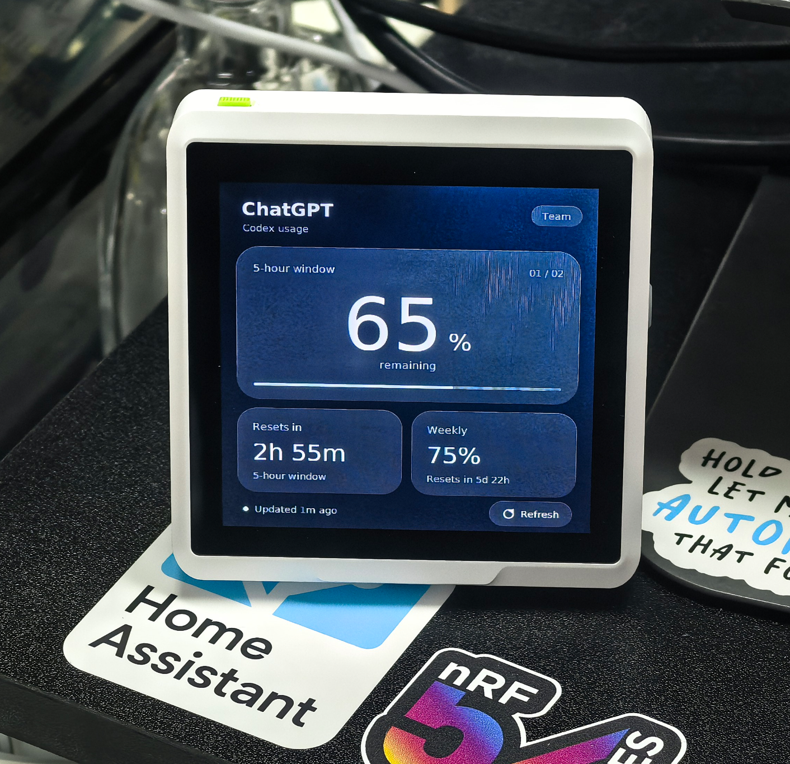

# SenseCAP Indicator AI Quota Monitor

A quiet desk display for your AI quota. Built for the **Seeed SenseCAP Indicator D1**, with a 480 × 480 touchscreen, a graphite glass interface and touch-to-wake.

[中文说明](README.zh-CN.md) · [Build from source](docs/BUILD.md) · [Troubleshooting](docs/TROUBLESHOOTING.md) · [MIT license](LICENSE)



*Running on a physical SenseCAP Indicator D1. Values reflect the moment the photo was taken.*

## What it does

- Shows remaining quota, the provider's actual usage windows and reset countdowns.
- Uses the Codex account already signed in on your computer; no API key in firmware.
- Queries every **5 minutes**, with automatic retries and USB reconnect.
- Hides stale or unavailable percentages instead of presenting an old number as current.
- Updates only changed screen regions to avoid full-screen redraw flicker.
- Turns the backlight off after **2 minutes without touch**. Touch anywhere to wake.
- Consumes the entire wake gesture, preventing accidental refresh, window switching or photo mode.
- Continues receiving quota while the screen is off, and composes current data before lighting it.

## What quota is this?

The validated source is **Codex usage limits returned for a ChatGPT-signed-in account**, using `codex app-server` → `account/rateLimits/read` and the `codex` limit bucket. The display heading says ChatGPT, with **Codex usage** underneath.

This is not the per-model message allowance in ChatGPT web chat and not your OpenAI API balance. Available windows depend on what the service returns; the app does not invent plan allowances. Service-side usage counters may have their own update delay.

| Source | State | Requirement |
|---|---|---|
| ChatGPT account / Codex quota | Tested on the physical D1 | Codex CLI, signed in with a ChatGPT account |
| Volcengine Agent Plan | Experimental adapter, not account/device validated | Official `arkcli`, authenticated account |
| OpenRouter credits | Experimental adapter, not account/device validated | Management key in a local environment variable |

## How it works

```text
Your signed-in computer ── online quota read ──> Python bridge
                                                    │ USB serial
                                                    ▼
                                          D1 touchscreen display
```

**A connected, awake computer is required.** This version does not query account data over the D1's Wi-Fi. Screen-off saves backlight power; it does not put the ESP32 or the computer into sleep.

## Quick start

### 1. Get the project and Python dependencies

Requires Python **3.10+**, Git, a data-capable USB cable and the D1's **ESP32-S3 CH340 USB-UART port**. Windows is hardware-tested; Linux/macOS foreground commands are provided but have not been hardware-validated.

```sh
git clone https://github.com/AYproject/sensecap-indicator-ai-quota.git
cd sensecap-indicator-ai-quota
python -m venv .venv
```

Windows PowerShell:

```powershell
.\.venv\Scripts\python.exe -m pip install -r requirements.txt
```

Linux/macOS:

```sh
.venv/bin/python -m pip install -r requirements.txt
```

Install the official [Codex CLI](https://github.com/openai/codex) and sign in with your ChatGPT account using `codex login`. An API-key-only login does not provide these subscription limits. To select a specific executable, set the local environment variable `D1_CODEX_EXE`.

### 2. Flash the D1 once

The repository contains **v0.5.2** images in `prebuilt/`, plus SHA-256 checksums. They are rebuilt from the hardware-validated application sources with build paths anonymized; see the exact [validation scope](docs/VALIDATION.md). Flashing the full image replaces existing firmware and flash contents. If you want to keep the original firmware/settings, first make a backup using [BUILD.md](docs/BUILD.md#back-up-and-flash).

Close any serial monitor and stop any running quota bridge before flashing. The D1 also exposes an **RP2040** USB device: select the **CH340** port, never the RP2040 port.

Windows example; replace `COM10` with your actual CH340 port:

```powershell
.\.venv\Scripts\python.exe -m pip install -r requirements-dev.txt
.\.venv\Scripts\python.exe -m serial.tools.list_ports -v
.\.venv\Scripts\python.exe tools/flash.py --port COM10
```

Linux/macOS: use `.venv/bin/python` and your CH340 serial path instead. The flasher checks USB VID/PID, forces the ESP32-S3 chip type and verifies the image checksum.

### 3. Start quota sync

Windows: double-click **Start-Demo.cmd**. It uses `.venv` when present, runs the bridge in the background, and refreshes immediately if already running. Run **Stop-Demo.ps1** to stop that checkout's bridge.

For visible diagnostics:

```powershell
.\.venv\Scripts\python.exe bridge/monitor.py --source codex --interval 300
```

Linux/macOS:

```sh
.venv/bin/python bridge/monitor.py --source codex --interval 300
```

The bridge automatically locates a unique D1 CH340, checks the firmware signature and remembers its USB identity. If several indistinguishable CH340 devices are connected, temporarily disconnect the others for the initial pairing. `--port` does not override ambiguous identity checks. Reconnecting the paired D1 or rebooting its screen triggers a fresh online lookup.

Restart the launcher after the computer reboots; this project does not install a system startup service. The computer needs an active login and internet connection.

## Touch controls

| Gesture | Action |
|---|---|
| Tap main quota / swipe sideways | Cycle the main quota window |
| Tap the other quota card | Promote that window to the main card |
| Tap Refresh | Request an online query, with short-interval rate limiting |
| Hold ~1.2 seconds while awake | Toggle photo freeze |
| Tap in photo mode | Resume live display |
| No touch for 2 minutes | Turn the backlight off |
| Touch anywhere while off | Wake only; release before another action |

Photo mode keeps receiving data but intentionally freezes the visible frame. It can also sleep; waking preserves photo mode, and a subsequent tap resumes normal updates.

## Data freshness and privacy

- Normal polling is every 300 seconds; failures retry after 15/30/60/120 seconds.
- Startup and reconnect show a syncing state until an online query succeeds.
- Failed reads, samples older than 15 minutes, unknown values and expired windows display `--`. A real `0%` displays `0%`.
- Cached snapshots retain their original sampling time and are never relabeled as fresh.
- The bridge asks Codex to manage its own authentication; it does not read or copy token files, and sends only normalized quota data to the D1.
- No model inference, credit purchase or quota reset is requested.
- Runtime files live in the ignored `private/` folder. They may contain quota telemetry and USB identifiers; do not publish that folder or attach it unredacted to an issue.

## Develop and extend

```sh
python -m unittest discover -s bridge -p "test_*.py"
python tools/check_firmware.py
```

See [BUILD.md](docs/BUILD.md) for pinned firmware dependencies and cross-platform build commands, [PROTOCOL.md](docs/PROTOCOL.md) for provider snapshots and USB packets, and [VALIDATION.md](docs/VALIDATION.md) for what has actually been tested.

```text
firmware/D1_AI_Quota/   Arduino sketch, display and touch implementation
libraries/D1_GFX/      D1-specific Arduino_GFX subset, with original license
bridge/                Online readers, freshness policy, USB transport and tests
tools/                 Build, flash, asset generation and checksum utilities
prebuilt/              v0.5.2 images, checksums and dependency notices
docs/                  Build, protocol, troubleshooting and validation notes
```

## License

Original project code is **MIT**. Bundled graphics code and the renamed font derivatives retain their own licenses. See [THIRD_PARTY_NOTICES.md](THIRD_PARTY_NOTICES.md) and [FONT_LICENSE.txt](FONT_LICENSE.txt).
