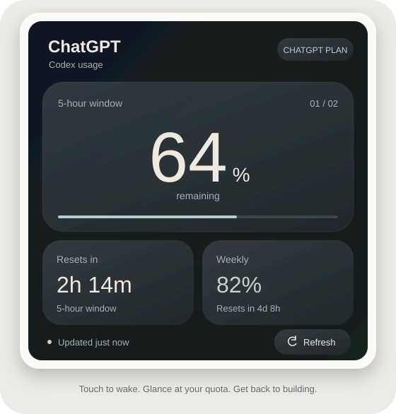

# SenseCAP Indicator AI 额度屏

把 **Seeed SenseCAP Indicator D1** 变成桌面上的 AI 额度仪表盘：480 × 480 触摸屏，深灰玻璃质感界面，自动息屏、触摸唤醒。

[English](README.md) · [源码编译](docs/BUILD.md) · [故障排查](docs/TROUBLESHOOTING.md) · [MIT 开源协议](LICENSE)



*图中为示意数值，不是实际账号截图。*

## 能做什么

- 显示剩余额度、服务实际返回的 5 小时/每周等窗口和重置倒计时。
- 电脑每 5 分钟在线读取一次；失败后自动重试，USB 重新连接自动恢复同步。
- 过期、未知或查询失败的数值显示 `--`，避免把昨天的百分比当作今天的新数据。
- 局部刷新，减少整屏重绘带来的闪烁。
- **2 分钟无触摸自动息屏，触摸任意位置唤醒**。
- 唤醒的第一整个触摸动作只点亮屏幕，避免误切换、误刷新或长按进入定格。
- 息屏期间继续接收数据，唤醒前重新检查数据有效期。
- 长按拍照定格，方便拍摄；再次轻点恢复。

## 数据范围先说清楚

已做真机验证的来源是：**ChatGPT 登录账号下的 Codex 配额**，通过 Codex CLI 的 `app-server` → `account/rateLimits/read` 读取 `codex` 额度桶。

界面主标题为 ChatGPT，副标题为 Codex usage。当前并未读取 ChatGPT 网页聊天中各模型的消息次数，也不是 OpenAI API 余额。窗口长度、套餐名和百分比取自服务返回，服务端统计本身可能存在更新延迟。

另外附有火山 Agent Plan 和 OpenRouter 余额适配代码，状态为**实验性**，没有做对应真实账号和设备的在线验收。

**当前需要 D1 通过 USB 接到正在运行同步程序的电脑，电脑需联网。** 本版没有让 D1 通过 Wi-Fi 独立查询账号。息屏仅关闭背光，不会让 ESP32 深度睡眠，也不会让电脑休眠。

## 快速开始：Windows

准备 Python 3.10+、Git、可传输数据的 USB 线，以及已用 ChatGPT 账号登录的 [Codex CLI](https://github.com/openai/codex)。API key 登录无法提供此类订阅额度。

```powershell
git clone https://github.com/AYproject/sensecap-indicator-ai-quota.git
cd sensecap-indicator-ai-quota
python -m venv .venv
.\.venv\Scripts\python.exe -m pip install -r requirements.txt
```

安装并通过 `codex login` 登录官方 Codex CLI。若需指定其位置，可在本地设置 `D1_CODEX_EXE` 环境变量，无须把凭据写进代码。

### 首次刷机

先停止已有同步程序、关闭串口监视器。完整刷机包会覆盖原固件及原有 flash 内容，想保留出厂程序请先按 [BUILD.md](docs/BUILD.md#back-up-and-flash) 备份。

D1 同时有 ESP32-S3 和 RP2040。**只选择 CH340 对应的 ESP32-S3 串口，不要选择 RP2040。** 以下 COM10 只是示例，请按你电脑上显示的 CH340 端口替换。

```powershell
.\.venv\Scripts\python.exe -m pip install -r requirements-dev.txt
.\.venv\Scripts\python.exe -m serial.tools.list_ports -v
.\.venv\Scripts\python.exe tools/flash.py --port COM10
```

仓库已附 v0.5.2 固件和校验值，不必先安装 Arduino 才能刷机。需要修改界面或逻辑时再参照编译说明。

### 启动

双击 **Start-Demo.cmd**，同步程序会在后台运行。再次双击会立即请求一次在线刷新。运行 **Stop-Demo.ps1** 停止当前目录对应的同步程序。

如果想看输出，可在终端前台运行：

```powershell
.\.venv\Scripts\python.exe bridge/monitor.py --source codex --interval 300
```

默认自动识别唯一的 D1 CH340，核对固件状态后记录 USB 身份；串口号变化后自动重新配对。如果存在多台无法区分的 CH340，首次使用时暂时拔掉其他设备，不会仅按 `--port` 参数任意选中一个。

电脑重新开机后需重新双击启动，本项目不会安装开机启动服务。Linux/macOS 的前台运行方式见英文说明；目前真机验收环境是 Windows。

## 触摸操作

| 操作 | 效果 |
|---|---|
| 轻点主额度卡片或左右滑动 | 切换大数字对应的额度窗口 |
| 轻点其他额度卡片 | 把该窗口设为主卡片 |
| 点击 Refresh | 请求电脑在线刷新，连续触摸会限速 |
| 亮屏时长按约 1.2 秒 | 拍照定格 |
| 定格后轻点 | 恢复实时显示 |
| 2 分钟不触摸 | 自动息屏 |
| 息屏后轻触任意位置 | 仅唤醒；松手后下一次触摸正常操作 |

拍照定格时仍接收数据，也会自动息屏。唤醒保留定格状态，再轻点恢复最新数据。

## 数据与隐私

正常查询间隔为 300 秒；失败后按 15/30/60/120 秒重试。启动和重连先显示同步中；查询失败、未知值、超过 15 分钟未更新或已过重置时间的窗口显示 `--`。真实 `0%` 不会被当成未知值。

凭据由 Codex 自己管理；桥接程序不读取、复制 token 文件，不把凭据发送到屏幕。查询不会发起模型推理、购买额度或重置额度。

运行状态、历史快照和设备身份保存在本地 `private/`，已加入 `.gitignore`。其中可能包含额度记录和 USB 标识，不要随意公开该目录或把完整日志贴到 issue。

## 开发

```powershell
.\.venv\Scripts\python.exe -m unittest discover -s bridge -p "test_*.py"
.\.venv\Scripts\python.exe tools/check_firmware.py
```

详细资料：[编译与刷机](docs/BUILD.md)、[数据与串口协议](docs/PROTOCOL.md)、[验收范围](docs/VALIDATION.md)、[参与贡献](CONTRIBUTING.md)。

项目原创代码采用 MIT 协议；随附图形库、字体和编译依赖保留各自许可证，详见 [第三方声明](THIRD_PARTY_NOTICES.md)。
